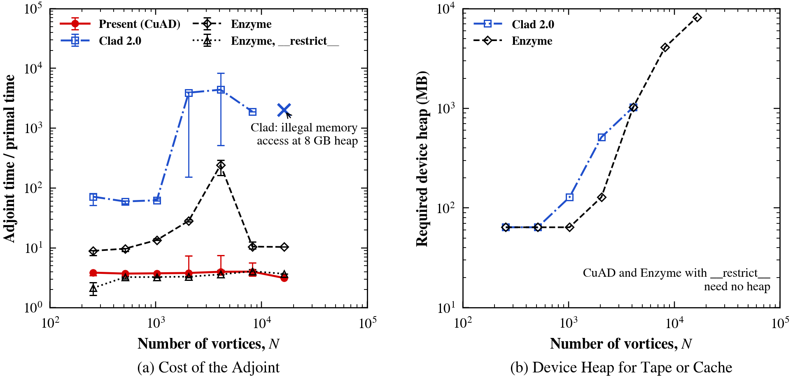
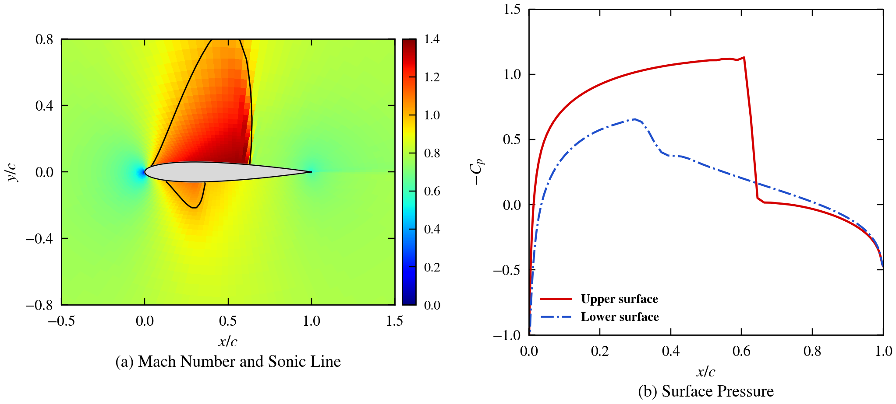
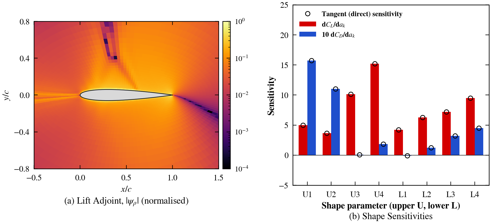
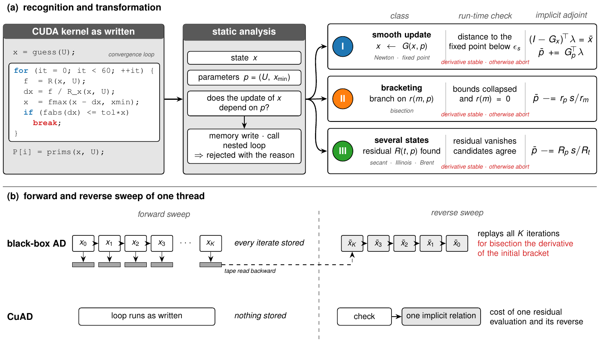
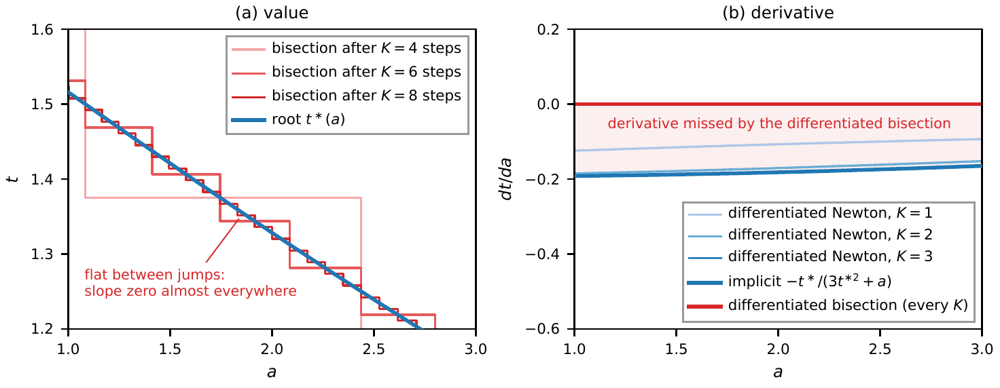
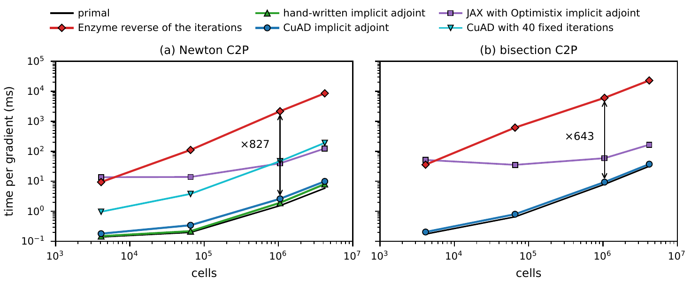
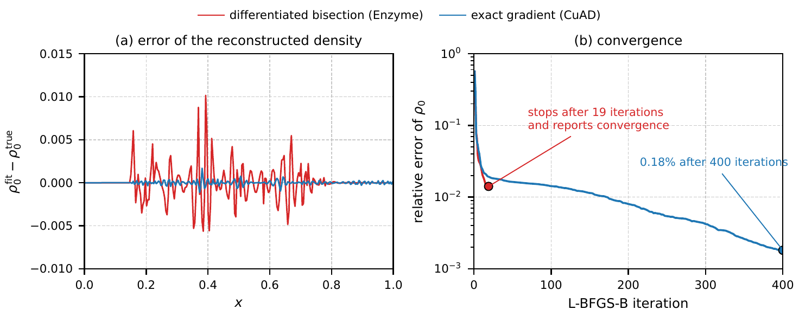

# CuAD — source-to-source automatic differentiation for CUDA

[](https://arxiv.org/abs/2610.26694)
[](https://github.com/SEUNGHYUN-JOO/CuAD/releases)
[](https://doi.org/10.5281/zenodo.24212012)
[](LICENSE)

**CuAD** (CUDA Automatic Differentiation) reads CUDA kernels and writes their derivatives as new CUDA source, in the
style of Tapenade: a **forward (tangent)** companion `f_d` and a **reverse (adjoint)**
companion `f_b` for each `__global__` / `__device__` function. It is built on
Clang LibTooling and differentiates the kernel math directly, so the derivatives are
exact (no finite differences) and the generated code runs on the GPU like the original.

CuAD was developed for the exact discrete adjoint of the
[CuDAFLOW](https://github.com/SEUNGHYUN-JOO/CuDAFlow) GPU RANS/LES solver, where it
differentiates the flux, viscous and turbulence-model residual kernels.

## Paper

S. Joo, *CuAD: Source-to-Source Automatic Differentiation of CUDA Kernels for Discrete
Adjoints in Computational Fluid Dynamics*, [arXiv:2610.26694](https://arxiv.org/abs/2610.26694)
(physics.flu-dyn), 2026. The kernels, drivers and raw results of every experiment are
included with the paper as ancillary files.

Main results:

- **Tape-free adjoints for flow-solver kernels.** CuAD adopts the convention of CUDA kernels
  that inputs and outputs do not alias, so the reverse sweep recomputes intermediate values
  instead of storing them. On a Biot–Savart summation compiled by one compiler (Clang 19), the
  CuAD adjoint costs about four times the primal kernel at every size up to 16384 vortices and
  uses no heap. Enzyme reaches the same cost once the source declares `__restrict__`; on the
  unchanged source its heap cache and the heap tape of Clad cost 9 to 4400 times the primal,
  and Clad fails beyond 8192 vortices.
- **Exact single-precision Jacobians.** A Jacobian assembled from the generated tangents by
  graph coloring keeps the adjoint gradients accurate to 1e-6 in single precision on a
  transonic airfoil, where single-precision finite differences give errors of 5e-4 to 4e-2.
- **A complete 2-D Euler adjoint.** For a transonic NACA 0012, the residual, the wall and
  far-field boundary conditions and the wall force are differentiated without change to the
  source; the lift and drag shape sensitivities from the adjoint and from the tangent agree
  to 1e-13.

<p align="center">
  
  <br><em>Biot–Savart adjoint of four tools under one compiler: cost relative to the primal
  kernel, and the device heap that the tape or cache of Clad and Enzyme requires.</em>
</p>

<p align="center">
  
  <br><em>Transonic NACA 0012 (M = 0.8, α = 1.25°) computed with the 2-D Euler kernels.</em>
</p>

<p align="center">
  
  <br><em>Lift adjoint and the lift and drag sensitivities to eight shape parameters, from the
  CuAD adjoint (bars) and from the CuAD tangent (circles).</em>
</p>

### Citation

```bibtex
@misc{joo2026cuad,
  author        = {Joo, Seunghyun},
  title         = {{CuAD}: Source-to-Source Automatic Differentiation of {CUDA} Kernels
                   for Discrete Adjoints in Computational Fluid Dynamics},
  year          = {2026},
  eprint        = {2610.26694},
  archivePrefix = {arXiv},
  primaryClass  = {physics.flu-dyn},
  doi           = {10.48550/arXiv.2610.26694}
}
```

## Implicit derivatives of convergence loops (v0.4)

Physics kernels often solve a small nonlinear equation in every thread with a loop that runs
until `if (c) break;` or until its condition fails. Differentiating the executed iterations
stores every iterate, and for bisection it returns the derivative of the initial bracket
instead of the derivative of the root, without any warning. CuAD recognizes such loops in
unchanged CUDA source and differentiates the converged solution through the relation it
satisfies, in reverse and in forward mode.

<p align="center">
  
  <br><em>(a) The static analysis places a loop in one of three classes or rejects it; the
  derivative code checks the exit state before it applies the implicit relation. (b) Black-box
  AD stores and replays every iterate; CuAD evaluates one relation at the exit state.</em>
</p>

- **Three classes found by static analysis.** A smooth update (Newton, fixed point, also a
  small system with a local-array state) gets (I - G_x)^T l = s solved directly, a bracketing
  update (bisection) gets the derivative of the root, and a loop with several iterated states
  (secant, Illinois regula falsi, Brent) is differentiated through a residual that the analysis
  finds in the loop body. `for`, `while` and `do` loops are accepted. Nothing is stored per
  iteration.
- **Run-time checks instead of silent errors.** The derivative traps when the loop left away
  from a solution (the estimated distance, not just the last step, which hides a slow
  contraction), when the relation it solved is ambiguous, or when the derivative is not
  determined there (a double root).
- **Verified against independent references.** On the conservative-to-primitive step of
  special-relativistic hydrodynamics (SRHD), the implicit adjoints of Newton, bisection,
  regula falsi and Brent match a 50-digit Jacobian to a median relative error below 1e-13.
  Enzyme's differentiated bisection has a median error of 0.41 on the same states.
- **GPU cost.** At 2^20 cells the implicit adjoint costs 1.7 times the Newton primal and 1.2
  times the bisection primal. Enzyme's differentiated iterations take 830 and 640 times as long as the CuAD adjoint.
- **Application.** The discrete adjoint of 1-D and 2-D SRHD solvers written as ordinary CUDA
  reconstructs the density of a medium from the passage of a relativistic shock: 0.18 % error
  in 1-D, and 3456 unknowns to 0.28 % in about one minute on the GPU in 2-D.

<p align="center">
  
  <br><em>Root of t³ + a t − 5 = 0. Bisection converges to the root in value but its
  differentiated iterates keep the derivative of the constant bracket (zero) for every K.</em>
</p>

<p align="center">
  
  <br><em>Time of one conservative-to-primitive gradient on an RTX 5080 against the number of cells.</em>
</p>

<p align="center">
  
  <br><em>1-D reconstruction with the bisection C2P. With the gradient of the differentiated
  bisection the optimizer stops early and reports convergence.</em>
</p>

The scripts, drivers and raw results of these experiments are in
[`research/srhd/`](research/srhd/); `bash research/srhd/reproduce_all.sh` regenerates every
table and figure.

## Example

Input (`test/cases/scalar.cu`):

```cuda
__global__ void apply_f(const double *x, double *y, double a, int n)
{
    int i = blockIdx.x * blockDim.x + threadIdx.x;
    if (i < n) {
        double xi = x[i];
        double t = sin(a * xi) + xi * xi;
        y[i] = t;
    }
}
```

`./cuad -r test/cases/scalar.cu` generates the adjoint kernel:

```cuda
__global__ void apply_f_b(const double * x, double *x_b, double * y, double *y_b, double a, int n)
{
  ...
  if (i < n) {
    double _cuad_b0 = y_b[i];
    y_b[i] = 0;
    t_b += _cuad_b0;
    xi_b += (a)*((cos(a * xi))*(t_b));
    xi_b += (t_b)*(xi);
    xi_b += (xi)*(t_b);
    atomicAdd(&x_b[i], xi_b);
  }
}
```

## Features

- **Forward and reverse mode** for `__global__` and `__device__` functions, including
  calls between user functions (each callee gets its own companion).
- **Activity analysis**: only variables that depend on active inputs are differentiated
  (forward dependence analysis).
- **Recompute rather than store**: loops that declare locals are recomputed iteration by
  iteration in the reverse sweep. Scalars that such a loop carries from one iteration to the
  next are checkpointed at the top of every iteration; pure accumulations (`v = v + e`) are
  recognized and need no checkpoint. Local arrays that a loop both writes and reads (a
  recurrent state, `a[i] = f(a[i-1])`, a read followed by an overwrite) are checkpointed in the
  same way. Only the elements an iteration may write are saved: an index interval per write
  site, evaluated at run time from loop counters and unmodified variables (the whole array when
  an index is not of that form). A single snapshot at loop entry is used only when every access
  in the loop uses one index that is provably injective in the induction variable.
- **Per-thread tape for overwritten values**: values that must be restored are pushed to a
  fixed-size per-thread array (`cuad_rt.h`, size `CUAD_TAPE_SIZE`, default 256), not to the
  device heap. With `-DCUAD_GLOBAL_TAPE` the tape is instead one device allocation sized at run
  time for the launched threads (`cuad_tape_alloc(threads, capacity)` before the launch); entries
  of neighboring threads are interleaved so that a warp pushes to contiguous memory, and nested
  adjoint calls stack their entries in the thread's column. Use it when a loop's checkpoints are
  too long for thread-local memory, which CUDA reserves for every thread that can be resident.
- **GPU-safe adjoint accumulation**: adjoints of shared arrays use `atomicAdd`, while
  thread-local arrays and scalars use plain `+=`.
- **Loops**: grid-stride loops, loops with local declarations (recomputed per
  iteration in the reverse sweep), `#pragma unroll`, early exits (`continue`, `return`).
- **Convergence loops (reverse and forward mode)**: a `for`, `while` or `do` loop that iterates
  floating locals (scalars or a local array) until `if (c) break;` or until its condition fails
  (a Newton or fixed-point solve, a bisection, a secant or Brent root finder) is differentiated at
  its converged point instead of iteration by iteration, and nothing is stored per iteration.
  A smooth update x <- G(x, p) gets G_x and G_p from one sweep of one iteration per state
  component; (I - G_x)^T l = s (reverse) or (I - G_x) x' = G_p p' (forward) is solved directly,
  so a slowly contracting loop costs no more than a fast one. A bracketing update, where the
  inputs reach the bracket only through the branch `if (r(m) > 0) lo = m; else hi = m;`, gets
  the root's derivative -r_p / r_m: differentiating its iterations would give the derivative of
  the initial bracket, not of the root. A loop with several iterated variables and no smooth map
  (secant, regula falsi, Brent) is differentiated through the residual it evaluates: a value
  computed from one trial point and the inputs that steers the loop (it is tested in a condition
  or feeds the update of the state). All candidates are evaluated at the exit state; when several
  vanish they must agree on the root and on its derivative, otherwise the derivative traps.
  Iteration counters (`++it`) and calls to functions that CuAD verifies to be pure (parameters by
  value, a floating result, no variable other than its parameters and locals, no pointer access,
  only pure callees) may appear in the body; loops that write other memory or nest other loops are
  rejected.
  At run time the exit state must lie within `CUAD_SOLVE_TOL` (relative, default 1e-6) of a
  solution: the distance (I - G_x)^-1 (G(x) - x) for a smooth update, the bracket width, or
  |R / R_t|. The derivative is evaluated again at the far side of that interval and must agree
  to `CUAD_SOLVE_AGREE` (default 1e-4); a double root or a degenerate fixed point therefore
  traps instead of returning an arbitrary value. The second evaluation is skipped for a smooth update
  whose entries of G_x all lie below 1/4 (Newton's method at a simple root); `-DCUAD_SOLVE_CHECK=2`
  never skips it and `-DCUAD_SOLVE_CHECK=0` removes all checks (for measurements only). A bracket that collapses onto a bound because the
  root lies outside it gives that bound's derivative. `CUAD_SOLVE_ATOL` (absolute, in the units
  of the state, default 0) is the absolute part of every test.- **C++ constructs**: function templates, default arguments, `float &` output
  parameters, local pointers and arrays of pointers, `c ? a : b`, multi-declarator
  statements, bare `{ ... }` blocks.
- **Math library**: `sin`, `cos`, `tan`, `exp`, `log`, `sqrt`, `tanh`, `fabs`, `pow`,
  `fmin`, `fmax`, `atan`, `atan2`, `asin`, `acos`, `copysign`, `hypot`, `cbrt` (float
  and double); `floor` / `ceil` / `round` / `trunc` are treated as piecewise constant.

### Conventions and limits

- **Inputs and outputs do not alias.** The reverse sweep reads a kernel's inputs again after
  the forward sweep has written its outputs, so a kernel must not overwrite the arrays it reads
  (the property that `__restrict__` declares). Split an in-place update into a kernel that
  reads and a kernel that writes.
- The per-thread tape has a compile-time size (`-DCUAD_TAPE_SIZE=...`), or the run-time
  capacity of the global tape. A loop that carries non-accumulated scalars or local arrays stores
  them in every iteration (a carried array: the region the iteration may write), so its tape grows
  with the trip count. Overflow traps, and so does a global-tape thread index outside the
  allocation. The global tape's thread index is the linear index over the whole grid.
- A `__global__` kernel's scalar parameters are uniform across the launch and are held
  passive (no adjoint argument). Make a quantity an array if its derivative is needed.
- `if` conditions are re-evaluated in the reverse sweep, so a branch must not reassign a
  variable that its own condition reads.
- Local arrays are analyzed by name. Inside a loop, an array passed whole (to a call, to a
  pointer) is treated as written and read; writes made later through a pointer that was taken
  outside the loop are not seen, so do not alias a local array with a local pointer.
- Integer locals are not taped: give a reassigned integer local a new variable for each
  value it takes.
- Not supported in reverse mode: `switch` statements, and `while` and `do` loops or `for` loops
  that exit with `break` other than the convergence loops above, when they touch active data.
  The derivative of a convergence loop is that of the solution of the equation it solves; the
  run-time tests above check that the loop reached it. Lambdas and straight-line in-place updates
  of a local-array element that an earlier statement also reads are not supported in either mode.
- **Unsupported constructs are rejected.** CuAD reports each one as
  `file:line:col: error: ...` and exits with status 3; the code it still writes is
  marked with `TODO(cuad)` comments and its derivatives are not valid there.
  `--allow-unsupported` turns these errors into notes and exits 0. Constructs that are
  supported but need care (a non-canonical loop, a dropped integer return value) are
  reported as warnings.
- A clean exit is not a proof of correctness. Verify new kernels with finite
  differences or a dot-product test, as the scripts in `test/` do.

## Build

Requirements: Linux, `g++` with C++17, and Clang/LLVM 14 development files.

```bash
sudo apt-get install -y libclang-14-dev llvm-14-dev
./build.sh                  # or: cmake -S . -B build && cmake --build build
```

`build.sh` uses `llvm-config-14` when it is available, otherwise `LLVM_DIR`
(default `/usr/lib/llvm-14`).

## Usage

The command-line tool is `cuad`:

```bash
./cuad    kernel.cu [function] > kernel_d.cuh   # forward (tangent) mode
./cuad -r kernel.cu [function] > kernel_b.cuh   # reverse (adjoint) mode
```

Without `function`, every function defined in the file is differentiated. The generated
code includes `cuad_rt.h` (tape and `atomicAdd` helpers, in `test/`).

Exit status: `0` success, `1` usage or file error, `2` the source did not parse,
`3` unsupported constructs were found (see the `error:` lines on standard error).

## Tests and examples

```bash
bash test/run_tests.sh
```

The suite checks the generated tangents and adjoints against central finite differences
and with adjoint dot-product tests (`<y_b, J x_d> = <J^T y_b, x_d>`). The kernels are
compiled for the host, so no GPU is needed to run it.

- `test/cases/` — small kernels: scalar math, loops and arrays, overwritten values,
  device-function calls, `atomicAdd` scatter.
- `examples/` — kernels from CuDAFLOW: conservative-to-primitive conversion and cell
  volumes, plus small applications driven by the generated adjoints: mesh shape
  optimization, NACA 0012 inverse design, and Spalart–Allmaras field inversion (FIML).
- `examples/srhd/` — one- and two-dimensional special-relativistic hydrodynamics in plain
  CUDA, whose conservative-to-primitive step is a per-cell root solve (Newton or bisection),
  with optional implicit cooling, and host drivers for the discrete adjoint of the whole
  time integration. `research/srhd/` holds the experiments of the accompanying manuscript
  (verification against analytic and 50-digit references, GPU comparison with Enzyme, Clad
  and JAX/Optimistix, inverse problems); `bash research/srhd/reproduce_all.sh` regenerates
  every table and figure.

## License

GPL-3.0. See [LICENSE](LICENSE).
