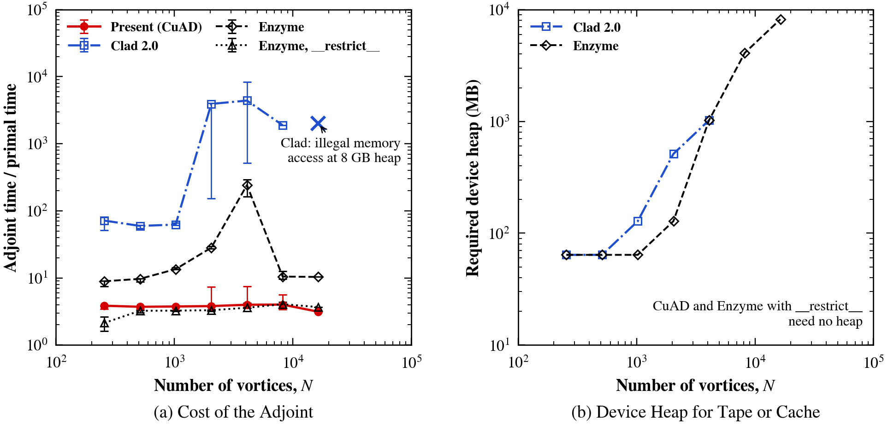
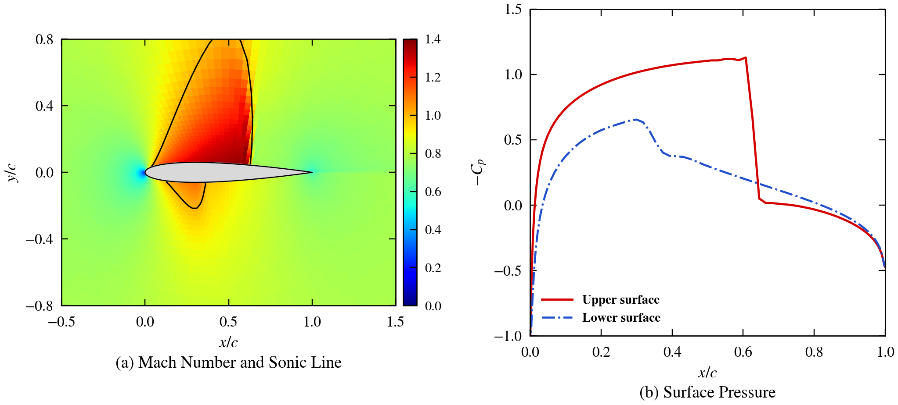
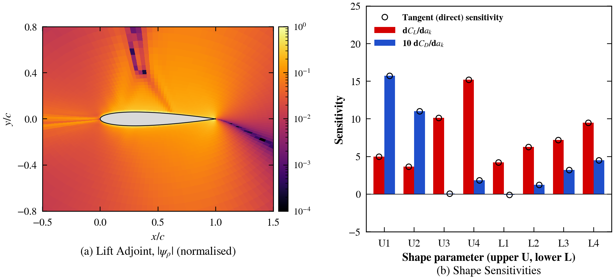

# CuAD — source-to-source automatic differentiation for CUDA

[](https://arxiv.org/abs/2610.26694)
[](https://github.com/SEUNGHYUN-JOO/CuAD/releases)
[](LICENSE)

**CuAD** (CUDA Automatic Differentiation) reads CUDA kernels and writes their derivatives as new CUDA source, in the
style of Tapenade: a **forward (tangent)** companion `f_d` and a **reverse (adjoint)**
companion `f_b` for each `__global__` / `__device__` function. It is built on
Clang LibTooling and differentiates the kernel math directly, so the derivatives are
exact (no finite differences) and the generated code runs on the GPU like the original.

CuAD was developed for the exact discrete adjoint of the
[CuDAFLOW](https://github.com/SEUNGHYUN-JOO/CuDAFlow) GPU RANS/LES solver, where it
differentiates the flux, viscous and turbulence-model residual kernels.

## Paper

S. Joo, *CuAD: Source-to-Source Automatic Differentiation of CUDA Kernels for Discrete
Adjoints in Computational Fluid Dynamics*, [arXiv:2610.26694](https://arxiv.org/abs/2610.26694)
(physics.flu-dyn), 2026. The kernels, drivers and raw results of every experiment are
included with the paper as ancillary files.

Main results:

- **Tape-free adjoints for flow-solver kernels.** CuAD adopts the convention of CUDA kernels
  that inputs and outputs do not alias, so the reverse sweep recomputes intermediate values
  instead of storing them. On a Biot–Savart summation compiled by one compiler (Clang 19), the
  CuAD adjoint costs about four times the primal kernel at every size up to 16384 vortices and
  uses no heap. Enzyme reaches the same cost once the source declares `__restrict__`; on the
  unchanged source its heap cache and the heap tape of Clad cost 9 to 4400 times the primal,
  and Clad fails beyond 8192 vortices.
- **Exact single-precision Jacobians.** A Jacobian assembled from the generated tangents by
  graph colouring keeps the adjoint gradients accurate to 1e-6 in single precision on a
  transonic airfoil, where single-precision finite differences give errors of 5e-4 to 4e-2.
- **A complete 2-D Euler adjoint.** For a transonic NACA 0012, the residual, the wall and
  far-field boundary conditions and the wall force are differentiated without change to the
  source; the lift and drag shape sensitivities from the adjoint and from the tangent agree
  to 1e-13.

<p align="center">
  
  <br><em>Biot–Savart adjoint of four tools under one compiler: cost relative to the primal
  kernel, and the device heap that the tape or cache of Clad and Enzyme requires.</em>
</p>

<p align="center">
  
  <br><em>Transonic NACA 0012 (M = 0.8, α = 1.25°) computed with the 2-D Euler kernels.</em>
</p>

<p align="center">
  
  <br><em>Lift adjoint and the lift and drag sensitivities to eight shape parameters, from the
  CuAD adjoint (bars) and from the CuAD tangent (circles).</em>
</p>

### Citation

```bibtex
@misc{joo2026cuad,
  author        = {Joo, Seunghyun},
  title         = {{CuAD}: Source-to-Source Automatic Differentiation of {CUDA} Kernels
                   for Discrete Adjoints in Computational Fluid Dynamics},
  year          = {2026},
  eprint        = {2610.26694},
  archivePrefix = {arXiv},
  primaryClass  = {physics.flu-dyn},
  doi           = {10.48550/arXiv.2610.26694}
}
```

## Example

Input (`test/cases/scalar.cu`):

```cuda
__global__ void apply_f(const double *x, double *y, double a, int n)
{
    int i = blockIdx.x * blockDim.x + threadIdx.x;
    if (i < n) {
        double xi = x[i];
        double t = sin(a * xi) + xi * xi;
        y[i] = t;
    }
}
```

`./cuad -r test/cases/scalar.cu` generates the adjoint kernel:

```cuda
__global__ void apply_f_b(const double * x, double *x_b, double * y, double *y_b, double a, int n)
{
  ...
  if (i < n) {
    double _cuad_b0 = y_b[i];
    y_b[i] = 0;
    t_b += _cuad_b0;
    xi_b += (a)*((cos(a * xi))*(t_b));
    xi_b += (t_b)*(xi);
    xi_b += (xi)*(t_b);
    atomicAdd(&x_b[i], xi_b);
  }
}
```

## Features

- **Forward and reverse mode** for `__global__` and `__device__` functions, including
  calls between user functions (each callee gets its own companion).
- **Activity analysis**: only variables that depend on active inputs are differentiated
  (forward dependence analysis).
- **Recompute rather than store**: loops that declare locals are recomputed iteration by
  iteration in the reverse sweep. Scalars that such a loop carries from one iteration to the
  next are checkpointed at the top of every iteration; pure accumulations (`v = v + e`) are
  recognised and need no checkpoint.
- **Thread-local tape for overwritten values**: values that must be restored are pushed to a
  fixed-size per-thread array (`cuad_rt.h`, size `CUAD_TAPE_SIZE`, default 256), not to the
  device heap.
- **GPU-safe adjoint accumulation**: adjoints of shared arrays use `atomicAdd`, while
  thread-local arrays and scalars use plain `+=`.
- **Loops**: grid-stride loops, loops with local declarations (recomputed per
  iteration in the reverse sweep), `#pragma unroll`, early exits (`continue`, `return`).
- **C++ constructs**: function templates, default arguments, `float &` output
  parameters, local pointers and arrays of pointers, `c ? a : b`, multi-declarator
  statements, bare `{ ... }` blocks.
- **Math library**: `sin`, `cos`, `tan`, `exp`, `log`, `sqrt`, `tanh`, `fabs`, `pow`,
  `fmin`, `fmax`, `atan`, `atan2`, `asin`, `acos`, `copysign`, `hypot`, `cbrt` (float
  and double); `floor` / `ceil` / `round` / `trunc` are treated as piecewise constant.

### Conventions and limits

- **Inputs and outputs do not alias.** The reverse sweep reads a kernel's inputs again after
  the forward sweep has written its outputs, so a kernel must not overwrite the arrays it reads
  (the property that `__restrict__` declares). Split an in-place update into a kernel that
  reads and a kernel that writes.
- The per-thread tape has a compile-time size (`-DCUAD_TAPE_SIZE=...`). A loop that carries
  non-accumulated scalars stores them in every iteration, so its tape grows with the trip count.
- A `__global__` kernel's scalar parameters are uniform across the launch and are held
  passive (no adjoint argument). Make a quantity an array if its derivative is needed.
- `if` conditions are re-evaluated in the reverse sweep, so a branch must not reassign a
  variable that its own condition reads.
- In-place updates of array elements inside loops must be per-element per iteration.
- Integer locals are not taped: give a reassigned integer local a new variable for each
  value it takes.
- Not supported in reverse mode: `while`, `do` and `switch` statements and `for` loops
  that exit with `break`, when they touch active data. Lambdas and straight-line
  in-place updates of a local-array element that an earlier statement also reads are
  not supported in either mode.
- **Unsupported constructs are rejected.** CuAD reports each one as
  `file:line:col: error: ...` and exits with status 3; the code it still writes is
  marked with `TODO(cuad)` comments and its derivatives are not valid there.
  `--allow-unsupported` turns these errors into notes and exits 0. Constructs that are
  supported but need care (a non-canonical loop, a dropped integer return value) are
  reported as warnings.
- A clean exit is not a proof of correctness. Verify new kernels with finite
  differences or a dot-product test, as the scripts in `test/` do.

## Build

Requirements: Linux, `g++` with C++17, and Clang/LLVM 14 development files.

```bash
sudo apt-get install -y libclang-14-dev llvm-14-dev
./build.sh                  # or: cmake -S . -B build && cmake --build build
```

`build.sh` uses `llvm-config-14` when it is available, otherwise `LLVM_DIR`
(default `/usr/lib/llvm-14`).

## Usage

The command-line tool is `cuad`:

```bash
./cuad    kernel.cu [function] > kernel_d.cuh   # forward (tangent) mode
./cuad -r kernel.cu [function] > kernel_b.cuh   # reverse (adjoint) mode
```

Without `function`, every function defined in the file is differentiated. The generated
code includes `cuad_rt.h` (tape and `atomicAdd` helpers, in `test/`).

Exit status: `0` success, `1` usage or file error, `2` the source did not parse,
`3` unsupported constructs were found (see the `error:` lines on standard error).

## Tests and examples

```bash
bash test/run_tests.sh
```

The suite checks the generated tangents and adjoints against central finite differences
and with adjoint dot-product tests (`<y_b, J x_d> = <J^T y_b, x_d>`). The kernels are
compiled for the host, so no GPU is needed to run it.

- `test/cases/` — small kernels: scalar math, loops and arrays, overwritten values,
  device-function calls, `atomicAdd` scatter.
- `examples/` — kernels from CuDAFLOW: conservative-to-primitive conversion and cell
  volumes, plus small applications driven by the generated adjoints: mesh shape
  optimisation, NACA 0012 inverse design, and Spalart–Allmaras field inversion (FIML).

## License

GPL-3.0. See [LICENSE](LICENSE).
